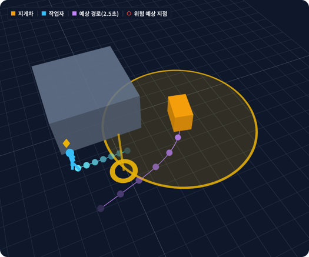
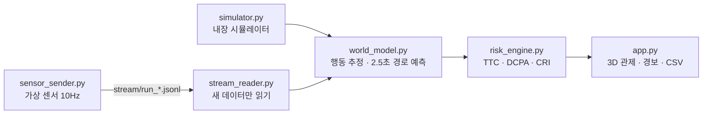

# SafePredict 3D

**월드 모델 기반 산업현장 충돌 위험 예측 및 3D 안전 관제 PoC**

지게차와 작업자의 위치 데이터를 받아 2.5초 뒤 경로를 예측하고, 부딪히기 전에 위험을 알려 주는 3D 관제 화면입니다.

- 배포 주소: https://safepredict-3d.streamlit.app/
- 개발 기간: 2026.11.12 ~ 2026.11.24 (개인 프로젝트)

> 가상 시뮬레이션 데이터와 시연용 임시 규칙으로 만든 PoC입니다. 실제 산업현장의 안전 제어 기준으로 사용할 수 없습니다.



코너 회전(S06) 장면: 지게차의 예상 경로가 작업자 쪽으로 휘는 순간

## 왜 만들었나

지금 위치와 속도만 보는 방식은 방향이 바뀌는 상황에서 경보가 늦습니다. 지게차가 모퉁이를 돌아 작업자 쪽으로 향하는 시나리오(S06)에서, 현재 값만으로 판정하면 충돌 거리 도달 0.5초 전에야 위험 경보가 뜹니다. 그래서 직전 움직임에서 가속·회전을 추정해 2.5초 앞의 경로를 예측하고, 그 예측까지 반영해 위험 단계를 판정하도록 했습니다.

## 주요 기능

| 구분 | 내용 |
|---|---|
| 가상 데이터 생성 | 지게차 1대와 작업자 1~5명의 위치·속도를 10Hz로 생성, 시나리오 7종 |
| 충돌 위험 계산 | 거리, 상대속도, TTC, DCPA, 동적 안전 버블, CRI(0~1) |
| 경로 예측 | 직전 틱과 비교해 가속도·회전 속도를 추정하고, 신경망으로 2.5초(25스텝) 경로 예측 |
| 위험 단계 판정 | 통합 CRI로 정상 / 주의 / 위험 3단계 판정, 작업자마다 따로 판정 |
| 3D 관제 화면 | 안전 버블, 예상 경로, 위험 예상 지점, 작업자별 경고 표시, 관제 시점·1인칭 시점 |
| 경보와 권장 조치 | 화면 전체 폭 경보 배너에 위험 단계, 대상 작업자, 남은 시간, 권장 조치 표시 |
| 가상 자동 대응 | 주의 단계에서 지게차 서행, 위험 단계에서 비상 정지 (시뮬레이터 안에서만 동작) |
| 실시간 수신 모드 | 별도 송신 프로그램이 보낸 위치 데이터를 받아 같은 과정으로 판정 |
| 기록 | 위험 단계 변경 이력, 이벤트 로그·틱별 계산 결과 CSV 내려받기, 계산 시간·수신 지연 표시 |

## 시스템 구성



- **내장 시뮬레이터 모드**: `simulator.py`가 만든 데이터를 앱이 바로 계산합니다.
- **실시간 수신 모드**: `sensor_sender.py`가 0.1초마다 파일에 한 줄씩 쓰고, 앱이 `stream_reader.py`로 새로 들어온 줄만 읽어 같은 계산 과정에 넣습니다.

## 위험 판정 방식

```text
TTC 점수   = clip((6 - TTC) / 5, 0, 1)                    # 충돌 예상 없으면 0
안전 버블  = 3.0 + 0.5 × 지게차 속력 (m)
거리 점수  = clip((안전 버블 - 거리) / (안전 버블 - 1), 0, 1)
현재 CRI   = max(TTC 점수, 거리 점수)
예측 CRI   = 예측한 25개 시점 각각의 CRI 중 최댓값
통합 CRI   = max(현재 CRI, 0.9 × 예측 CRI)
```

| 통합 CRI | 단계 | 화면 | 가상 자동 대응 (켰을 때) |
|---|---|---|---|
| 0.50 미만 | SAFE | 정상 | - |
| 0.50 이상 0.85 미만 | WARNING | 주의 | 지게차를 1.0 m/s까지 감속 |
| 0.85 이상 | CRITICAL | 위험 | 지게차와 작업자 모두 정지 |

- TTC는 두 객체의 중심 간 거리가 처음으로 1m 이하가 되기까지 걸리는 시간입니다.
- 작업자가 여러 명이면 통합 CRI가 가장 큰 작업자의 단계가 전체 단계가 됩니다.
- 이벤트는 최초 판정(`INIT`)과 단계가 바뀔 때(`LEVEL_CHANGE`)만 1건씩 기록합니다.
- 세부 계산식과 예외 처리는 [`docs/risk_rules.md`](docs/risk_rules.md)에 있습니다.

## 경로 예측 모델

- 구조: 입력 6(상태 `x, y, vx, vy` + 행동 `가속도, 회전 속도`) → 64 → 64 → 출력 4인 신경망. 0.1초 뒤의 상태 변화량을 예측하고, 그 결과를 다시 입력해 25번 반복합니다.
- 학습: 물리식으로 만든 가상 전이 데이터 4,000건, 300회, 시드 42, CPU. 앱이 시작할 때 한 번 학습합니다.
- 행동 추정값은 학습 범위(가속도 ±1.5 m/s², 회전 속도 ±1.2 rad/s)로 제한합니다.

## 시나리오

| ID | 시나리오 | 내용 | 확인하는 것 |
|---|---|---|---|
| S01 | 정상 이동 | 8m 간격으로 나란히 이동 | 오경보가 없는지 |
| S02 | 정지 접근 | 정지한 지게차에 작업자가 접근 | 거리·TTC 감소와 단계 상승 |
| S03 | 정면 접근 | 지게차와 작업자가 마주 보고 접근 | 정상 → 주의 → 위험 진행 |
| S04 | 교차 이동 | 수직으로 만나는 두 경로 | 교차 경로의 TTC·DCPA |
| S05 | 접근 후 이탈 | 작업자가 다가오다 2초에 돌아섬 | 위험도 감소와 경보 해제 |
| S06 | 코너 회전 | 지게차가 1.8~3.3초에 좌회전해 작업자 쪽으로 향함 | 예측 기반 조기 경보 |
| S07 | 다중 작업자 | 작업자 5명 (가로지르기, 통로 옆 정지 작업, 나란히 이동 등) | 작업자별 판정 |

시작 위치와 종료 조건은 [`docs/scenarios.md`](docs/scenarios.md)에 있습니다.

## 결과

모두 가상 시뮬레이션 결과입니다.

**경보 시점**

| 시나리오 | 결과 |
|---|---|
| S06 코너 회전 | 현재 CRI만 쓰면 3.1초에 위험 경보, 통합 CRI는 1.8초에 주의·2.2초에 위험 경보 (충돌 거리 도달 3.6초) |
| S07 자동 대응 끔 | 충돌 거리 도달(10.6초, 0.89m)보다 주의는 6.4초, 위험은 4.0초 먼저 발생 |
| S07 자동 대응 켬 | 충돌 없이 종료, 가로지르는 작업자(WK_01)와의 최소 거리 7.98m |

**예측 정확도** (S06, 지게차, 등속도 예측 대비, 시드 42)

| 구간 | 표본 수 | 등속도 ADE | 모델 ADE | ADE 개선율 | FDE 개선율 |
|---|---|---|---|---|---|
| 회전 구간 | 16 | 1.884 m | 0.885 m | +53.0% | +48.2% |
| 비회전 구간 | 18 | 1.181 m | 1.438 m | -21.7% | -19.3% |
| 전체 | 34 | 1.512 m | 1.178 m | +22.1% | +14.1% |

측정 조건과 해석은 [`docs/evaluation.md`](docs/evaluation.md)에 있습니다.

**처리 성능** (S07 작업자 5명, 2026-11-22 각 1회 측정)

| 항목 | 목표 | 로컬 | 배포 주소 |
|---|---|---|---|
| 틱당 위험 계산 시간 (평균 / P95) | 100 ms 이하 | 16.7 / 20.3 ms | 15.9 / 20.1 ms |
| 수신 지연, 생성 → 처리 완료 (평균 / P95) | 로컬 1초, 클라우드 2초 이내 | 262 / 439 ms | 314 / 506 ms |

수신 지연은 서버가 처리를 끝낸 시점까지이며, 브라우저가 화면을 그리는 시간은 포함하지 않습니다.

## 실행 방법

### 로컬 실행

Python 3.12 기준입니다.

```bash
git clone https://github.com/shinsangaa/safepredict-3d.git
cd safepredict-3d

python -m venv venv
venv\Scripts\Activate.ps1        # Windows PowerShell
# source venv/bin/activate       # macOS · Linux

pip install -r requirements.txt
python -m streamlit run app.py
```

브라우저에서 http://localhost:8501 을 엽니다. 3D 화면은 Three.js를 CDN에서 불러오므로 인터넷 연결이 필요합니다.

### 실시간 수신 모드

1. 왼쪽 사이드바의 **데이터 입력**에서 **실시간 수신**을 선택합니다.
2. 시나리오를 고르고 **[시연용 송신 시작]** 을 누릅니다.

송신 프로그램을 터미널에서 직접 실행해도 됩니다. 앱에서 실시간 수신을 먼저 선택한 뒤 실행해야 처음부터 받습니다.

```bash
python sensor_sender.py --scenario multi_worker
```

`--scenario` 값: `parallel`(S01), `stop_approach`(S02), `head_on`(S03), `crossing`(S04), `retreat`(S05), `corner_turn`(S06), `multi_worker`(S07)

### Docker

컨테이너 하나로 실행:

```bash
docker build -t safepredict-3d .
docker run -p 8501:8501 safepredict-3d
```

관제(app)와 센서(sender)를 컨테이너 2개로 나눠 실행 (같은 이미지, 공유 볼륨 `stream-data`로 데이터 전달):

```bash
docker compose build
docker compose up app
# 브라우저에서 실시간 수신을 선택한 뒤, 새 터미널에서
docker compose run sender
# 정리
docker compose --profile send down
```

### 테스트와 평가

```bash
pip install pytest
python -m pytest -v test/test_risk_engine.py    # 단위 테스트 34개
python eval_prediction.py                       # 등속도 예측 대비 ADE·FDE 비교표 출력
python save_weights.py                          # 학습한 가중치를 models/world_model_weights.pt로 저장
```

## 프로젝트 구조

```text
safepredict-3d/
├── app.py                  # Streamlit 관제 화면 (Three.js 3D, 경보, 이력, CSV)
├── simulator.py            # 10Hz 가상 이동 시뮬레이터, 시나리오 S01~S07, 가상 자동 대응
├── risk_engine.py          # 거리·TTC·DCPA·CRI 계산, 위험 단계 분류
├── world_model.py          # 상태 전이 신경망 학습, 행동 추정, 2.5초 경로 예측
├── sensor_sender.py        # 가상 센서: 위치 데이터를 10Hz로 파일에 송신
├── stream_reader.py        # 송신 파일에서 새로 들어온 데이터만 읽기
├── eval_prediction.py      # 등속도 예측 대비 ADE·FDE 평가
├── save_weights.py         # 모델 가중치 파일 저장
├── test/
│   └── test_risk_engine.py # 단위 테스트
├── docs/
│   ├── requirements.md     # 요구사항 명세서
│   ├── scenarios.md        # 시나리오 명세서
│   ├── risk_rules.md       # 위험 계산 및 판정 규칙
│   ├── data_spec.md        # 데이터 명세서
│   └── evaluation.md       # 예측 성능 평가 결과
├── .streamlit/
│   └── config.toml         # 어두운 테마 설정
├── Dockerfile
├── docker-compose.yml
└── requirements.txt
```

## 기술 스택

| 구분 | 사용 기술 |
|---|---|
| 언어 | Python 3.12, JavaScript |
| 예측 모델 | PyTorch 2.15 (CPU) |
| 화면 | Streamlit 1.67, Three.js r128 |
| 데이터 처리 | pandas, NumPy |
| 배포 | Docker, Docker Compose, Streamlit Community Cloud |
| 검증 | pytest |

## 한계

- **가상 데이터와 임시 규칙**: 충돌 판정 거리 1m, 안전 버블 식, CRI 임계값은 시연용 설정값입니다. 실제 장비 크기와 제동 거리를 반영하지 않습니다.
- **예측 평가의 한계**: 학습 데이터와 평가용 시뮬레이터가 같은 물리식에서 나왔고, 비교 대상인 등속도 예측은 회전을 표현하지 못합니다. 회전 구간에서 모델이 앞서는 것은 예상할 수 있는 결과이며, 회전을 반영하는 물리 기반 예측(CTRV)과는 비교하지 않았습니다. 평가 표본도 S06의 지게차 34개뿐입니다.
- **직진 구간 오차**: 비회전 구간에서는 등속도 예측보다 오차가 큽니다 (ADE 21.7% 증가).
- **환경을 보지 않는 예측**: 모델은 객체의 위치·속도만 입력받습니다. 랙은 화면에만 그리고 예측과 충돌 계산에 반영하지 않습니다.
- **센서 잡음 미반영**: 잡음과 누락이 없는 좌표를 썼고, 오경보율을 측정하지 않았습니다.
- **경보 떨림**: 자동 대응을 켜면 주의 경보가 짧게 풀렸다 다시 걸립니다. 경보 유지 시간(히스테리시스)이 없습니다.
- **실행 환경에 따른 차이**: 앱이 시작할 때마다 모델을 새로 학습해서, 환경에 따라 경보 시각이 0.1~0.3초 달라집니다.
- **수신 방식**: 파일을 0.25초마다 확인하는 방식이라 수신 지연의 대부분이 대기 시간입니다. 배포 주소에서는 접속자 모두가 같은 수신 폴더를 씁니다.
- **현장 배치 고정**: 랙 배치가 코드 안에 시나리오별로 들어 있고, 지게차는 1대만 다룹니다.

## 다음 단계

- CTRV 등 물리 기반 예측을 기준선으로 두고 전 시나리오에서 다시 평가
- 위치 잡음을 넣은 데이터로 오경보율·미탐지율 측정
- 경보 유지 시간(히스테리시스) 적용
- 저장한 가중치를 불러와 환경이 달라도 같은 결과가 나오게 변경
- 현장별 배치 파일(`layouts/현장이름.json`)로 랙 배치를 코드에서 분리
- 위치 스트림은 메시지 브로커(Kafka 등)로, 이벤트는 PostgreSQL로 이전
- 실제 위치 센서 연동, 지게차 여러 대로 확장

## 문서

- [`docs/requirements.md`](docs/requirements.md): 기능·비기능 요구사항
- [`docs/scenarios.md`](docs/scenarios.md): 시나리오별 초기 조건과 종료 조건
- [`docs/risk_rules.md`](docs/risk_rules.md): TTC·DCPA·CRI 계산식과 판정 규칙
- [`docs/data_spec.md`](docs/data_spec.md): 입력·출력·이벤트 데이터 명세
- [`docs/evaluation.md`](docs/evaluation.md): 예측 성능 평가 결과